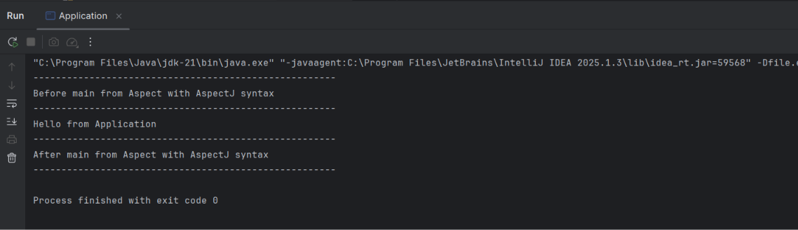
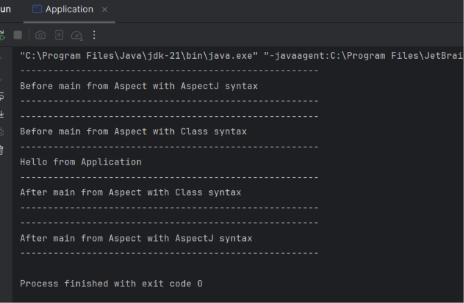
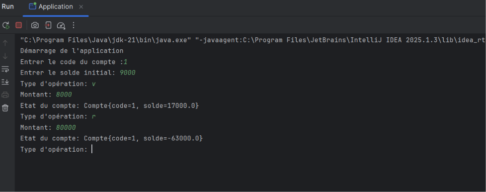
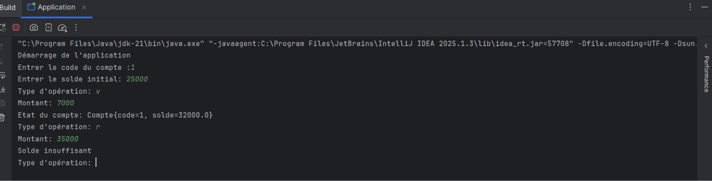
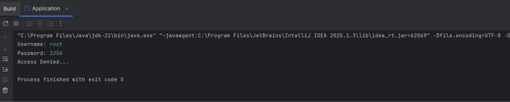
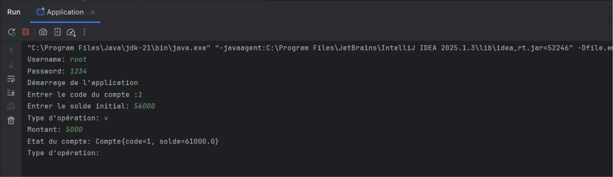

# TP sur la programmation orientée Aspect

## Introduction

La programmation orientée aspect (POA, ou AOP pour *Aspect-Oriented Programming*) consiste à regrouper dans des **aspects** les comportements qui concernent plusieurs parties d’une application. La journalisation, le contrôle d’accès et la mesure du temps d’exécution sont des exemples de préoccupations transversales.

Dans ce TP, le service bancaire gère les comptes et leurs soldes. Un aspect journalise ses opérations, un autre contrôle les retraits et un troisième vérifie les identifiants au démarrage de l’application. Centraliser ces comportements évite de répéter les mêmes instructions dans chaque méthode, rend le code métier plus lisible et permet de modifier une règle à un seul endroit.

| Notion | Rôle dans le TP |
| --- | --- |
| **Point de jonction** (*join point*) | Événement de l’exécution, par exemple l’exécution de la méthode `retirer`. |
| **Pointcut** | Expression qui sélectionne les points de jonction auxquels l’aspect s’applique. |
| **Advice** | Code exécuté avant, après ou autour des points sélectionnés. |
| **Tissage** (*weaving*) | Intégration des advice au programme. Dans ce TP, `ajc` réalise le tissage à la compilation. |

Un pointcut large peut couvrir plusieurs méthodes d’un coup. Il faut donc vérifier les cibles sélectionnées, surtout lorsque plusieurs aspects interviennent sur une même opération. [Guide de programmation AspectJ](https://eclipse.dev/aspectj/doc/latest/progguide/progguide.html)

## Partie 1 — Mise en œuvre avec AspectJ

### 1. Premiers advice autour de `main`

AspectJ permet d’écrire un aspect avec sa syntaxe native dans un fichier `.aj` ou dans une classe Java annotée avec `@Aspect`. Les deux formes ont été expérimentées avec le même pointcut, `execution(* net.zoungrana.test.Application.main(..))`.

Dans [`FirstAspect.aj`](src/main/java/net/zoungrana/aspects/FirstAspect.aj), les premiers advice `before()` et `after()` affichaient des messages de part et d’autre de `main` (`9aacce9`). Un advice `around()` les a ensuite remplacés (`217a0f1`). L’appel à `proceed()` laisse la méthode ciblée s’exécuter entre les deux messages.

*Figure 1 — L’advice `around` encadre l’affichage de `Hello from Application`.*

[`SecondAspect.java`](src/main/java/net/zoungrana/aspects/SecondAspect.java) reprend l’exercice avec `@Pointcut`, `@Before("pc1()")` et `@After("pc1()")` (`514efa4`), puis avec `@Around("pc1()")` et `ProceedingJoinPoint.proceed()` (`47c1de1`). La capture montre les messages des deux formes d’aspect autour du même appel. Ces premiers aspects sont conservés comme exemples commentés dans la version actuelle.

*Figure 2 — Les deux formes d’aspect interviennent autour de `Application.main`.*

### 2. Application bancaire en console

L’[application](src/main/java/net/zoungrana/test/Application.java) demande un code de compte et un solde initial. Le service [`MetierBanqueImpl`](src/main/java/net/zoungrana/metier/MetierBanqueImpl.java), qui implémente `IMetierBanque`, stocke les comptes en mémoire et expose les opérations `addCompte`, `verser`, `retirer` et `consulterCompte` (`eb88eb1`).

En console, `v` permet d’effectuer un versement, `r` un retrait et `quitter` termine la session. Avant l’ajout du contrôle de solde, un retrait de 80 000 sur un compte disposant de 17 000 produisait un solde de −63 000.

*Figure 3 — Le compte passe à un solde négatif avant l’ajout de la règle de retrait.*

### 3. Journalisation des opérations

[`LoggingAspect`](src/main/java/net/zoungrana/aspects/LoggingAspect.java) sélectionne les exécutions des méthodes déclarées dans `MetierBanqueImpl` avec `execution(* net.zoungrana.metier.MetierBanqueImpl.*(..))`. La première version mesure le temps d’exécution avec deux advice, `@Before` et `@After` (`8092614`).

La version suivante regroupe la mesure dans un advice `@Around` et redirige les messages de `java.util.logging` vers [`log.xml`](log.xml) avec un `FileHandler` (`f658b62`). L’advice journalise la signature de la méthode, appelle `proceed()` et, si l’exécution se termine normalement, consigne sa fin et sa durée avant de renvoyer le résultat. Dans le journal enregistré, un appel à `addCompte` comporte une entrée de début, une entrée de fin et une durée de 14 ms.

### 4. Contrôle du solde avant un retrait

[`PatchRetraitAspect`](src/main/java/net/zoungrana/aspects/PatchRetraitAspect.java) cible `MetierBanqueImpl.retirer(Long, double)`. L’expression `args(code, montant)` transmet le code du compte et le montant à l’advice `@Around`. L’aspect consulte le solde et appelle `proceed()` lorsque le montant demandé est inférieur ou égal au solde. Lorsque le solde est insuffisant, il lève une exception avec le message `Solde insuffisant` et le retrait est bloqué (`6486f00`).

*Figure 4 — Après un versement, le solde atteint 32 000. L’aspect refuse le retrait de 35 000.*

### 5. Authentification au démarrage

[`SecurityAspect`](src/main/java/net/zoungrana/aspects/SecurityAspect.java) intercepte l’exécution de `Application.start()`. L’advice `@Around` demande un identifiant et un mot de passe de démonstration, définis dans le code du TP. Si les deux correspondent, `proceed()` lance le menu bancaire. Sinon, l’advice affiche `Access Denied...` et la session s’arrête avant la création du compte (`a08552d`).

*Figure 5 — Identifiants incorrects, accès refusé.*

*Figure 6 — Identifiants valides, démarrage de l’application et versement de 5 000.*

### 6. Exécution dans IntelliJ IDEA

1. Ouvrir le projet Maven avec le **JDK 21**. Le [`pom.xml`](pom.xml) déclare `aspectjrt` en version **1.9.25.1**.
2. Activer le plugin **AspectJ**, puis sélectionner **Ajc** dans **Settings → Build, Execution, Deployment → Compiler → Java Compiler** et indiquer le chemin du JAR `aspectjtools-1.9.25.1.jar`.
3. Reconstruire le projet avec **Build → Rebuild Project**, puis lancer `net.zoungrana.test.Application`.
